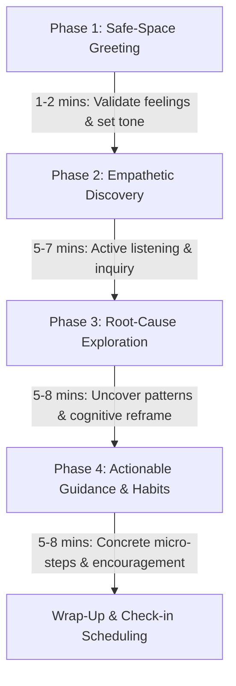

# 🌟 AI_AVATAR-XP (MindfulU)

### *Next-Generation AI-Powered Student Counseling & Wellness Platform with Interactive 3D/Video Avatars*

[](https://react.dev/)
[](https://www.typescriptlang.org/)
[](https://vitejs.dev/)
[](https://tailwindcss.com/)
[](https://ui.shadcn.com/)
[](https://livekit.io/)
[](https://beyondpresence.ai/)
[](https://firebase.google.com/)
[](https://n8n.io/)
[](https://opensource.org/licenses/MIT)

---

## 📌 Table of Contents

- [Overview](#-overview)
- [The Problem We Solve](#-the-problem-we-solve)
- [Core Features](#-core-features)
- [Specialized AI Counselor Personas](#-specialized-ai-counselor-personas)
- [System Architecture](#-system-architecture)
- [Counseling Protocol & Conversation Flow](#-counseling-protocol--conversation-flow)
- [Technology Stack](#-technology-stack)
- [Repository Structure](#-repository-structure)
- [Getting Started](#-getting-started)
  - [Prerequisites](#prerequisites)
  - [Installation](#installation)
  - [Environment Variables](#environment-variables)
  - [Running the Development Server](#running-the-development-server)
  - [Production Build](#production-build)
- [Academic Research & Reports](#-academic-research--reports)
- [Security & Ethical Guardrails](#-security--ethical-guardrails)
- [Roadmap](#-roadmap)
- [Contributing & License](#-contributing--license)

---

## 📖 Overview

**AI_AVATAR-XP** (branded as **MindfulU** / **Mindflow**) is an innovative, full-stack AI counseling platform designed to address the surging youth mental health and student guidance crisis. By pairing real-time WebRTC media pipelines with photorealistic, conversational AI avatars, the platform provides accessible, judgment-free, 24/7 empathetic guidance.

Students and young professionals can connect with 6 domain-specialized virtual counselors through **real-time video sessions** powered by **Beyond Presence** and **LiveKit**, or schedule **automated voice callbacks** orchestrated via **n8n workflow automation**. The conversational engine is culturally attuned to support seamless trilingual code-switching across **English, Hindi, and Hinglish**.

<p align="center">
  
</p>

---

## 🎯 The Problem We Solve

Traditional student and youth counseling services face critical structural bottlenecks:

1. **Severe Imbalance in Supply & Demand**: Most universities maintain a counselor-to-student ratio between 1:1,500 and 1:3,000, creating appointment wait times of 2 to 4 weeks.
2. **Social Stigma & Fear of Judgment**: Upwards of 80% of struggling students hesitate or refuse to walk into campus counseling centers due to privacy concerns and social stigma.
3. **Restricted Availability**: Crisis moments, exam anxiety, and insomnia-induced panic frequently strike late at night or over weekends when physical centers are closed.
4. **Prohibitive Private Costs**: High hourly rates of private psychological therapy place professional help far beyond the reach of average students.
5. **Language & Cultural Barriers**: Many students express their deepest emotional nuances naturally in blended languages like Hinglish, which traditional clinical setups rarely accommodate comfortably.

**AI_AVATAR-XP** eliminates these friction points by providing **immediate, anonymous, round-the-clock, trilingual guidance at zero marginal cost**.

---

## ⚡ Core Features

### 🎥 Real-Time Interactive AI Video Avatars
- **Photorealistic Lip-Sync & Micro-Expressions**: Powered by Beyond Presence rendering engines delivering facial responsiveness, head motion, and emotional cues.
- **Ultra-Low Latency**: Sub-second round-trip audio and video communication via LiveKit WebRTC edge infrastructure.
- **Live Session Metrics**: Integrated session timer, audio device controls, and seamless exit/re-entry flows.

### 📞 Automated Voice Callback Scheduling
- **Asynchronous Callback Engine**: Students who prefer telephone calls can schedule callbacks at their convenience.
- **n8n Automation Pipeline**: Dispatches webhooks to trigger calendar scheduling, intake logging, and automated telephony callbacks.

### 🌐 Native Trilingual Code-Switching
- **Fluid Multi-Dialect Understanding**: Full conversational fluency in **English**, **Hindi (Devanagari)**, and **Hinglish (Roman Hindi)**.
- **Dynamic Language Mirroring**: The AI counselors detect the user's conversational register and naturally adapt their responses to match.

### 🎨 Human Investigative & Wellness UI
- **Refined Aesthetics**: Thoughtfully designed with a calming palette, smooth glassmorphism, subtle micro-interactions, and accessible typography.
- **Dark & Light Mode Support**: Seamless toggle powered by `next-themes` and Tailwind CSS.
- **Onboarding & Assessment**: Interactive goal setting, stress self-reporting, and personalized counselor recommendation matching.

### 🔐 Secure Identity & Session Management
- **Firebase Authentication**: One-click Google Sign-In and secure session token validation.
- **History & Insights Tracking**: Log of previous sessions, time spent, and growth milestones while maintaining user anonymity.

---

## 👥 Specialized AI Counselor Personas

Rather than relying on a generic chatbot, AI_AVATAR-XP introduces **six distinct personas**, each equipped with comprehensive background profiles, curated knowledge bases, psychological frameworks, and distinct conversational approaches:

| Counselor | Persona & Domain | Background & Credentials | Key Areas of Focus |
|:---|:---|:---|:---|
|  **Dr. Priya Sharma** | **Health & Wellness** | MBBS (AIIMS Delhi), MD (Preventive Med), Certified MBSR & Clinical Nutrition | Stress management, chronic fatigue, sleep hygiene, holistic lifestyle, somatic calm |
|  **Arjun Mehta** | **Career Guidance** | MBA (IIM Bangalore), Former HR Director, Certified ICF-ACC Executive Coach | Career path discovery, resume/interview prep, career transitions, imposter syndrome |
|  **Dr. Anjali Reddy** | **Academic Support** | Ph.D. (IIT Bombay), Former Academic Dean, Specialist in Educational Psychology | Exam anxiety, ADHD-friendly study schedules, time management, thesis roadblocks |
|  **Rahul Kapoor** | **Financial Advice** | Chartered Accountant (CA), CFP, 11+ years student financial literacy | Student loan management, pocket-money budgeting, emergency funds, debt avoidance |
|  **Neha Patel** | **Social & Relationships** | M.A. Clinical Psychology (TISS Mumbai), Certified Family & Peer Mediator | Roommate conflicts, social anxiety, loneliness, boundary setting, heartbreak recovery |
|  **Rohan Gupta** | **Personal Development** | Certified ICF-PCC Life Coach, NLP Master Practitioner | Procrastination, identity crisis, atomic habit formation, self-confidence, goal mastery |

---

## 🏗️ System Architecture

The platform is structured into modular layers designed for high throughput, minimal video latency, and robust failure isolation:

```
┌─────────────────────────────────────────────────────────────────────────────┐
│                              CLIENT PRESENTATION                            │
│  ┌────────────────────────┐  ┌──────────────────────┐  ┌─────────────────┐ │
│  │   React 18 + Vite SPA  │  │  shadcn/ui + Radix   │  │ Lucide & Themes │ │
│  └────────────────────────┘  └──────────────────────┘  └─────────────────┘ │
│                                      │                                      │
│                ┌─────────────────────┴─────────────────────┐                │
│                ▼                                           ▼                │
│  ┌───────────────────────────┐               ┌───────────────────────────┐  │
│  │     Video Session Mode    │               │    Voice Callback Mode    │  │
│  │  (Beyond Presence / LiveKit)              │       (n8n Webhooks)      │  │
│  └───────────────────────────┘               └───────────────────────────┘  │
└───────────────────────┬─────────────────────────────────────┬───────────────┘
                        │                                     │
                        ▼                                     ▼
┌──────────────────────────────────────────────┐  ┌───────────────────────────┐
│              COMMUNICATION LAYER             │  │      AUTOMATION LAYER     │
│  ┌────────────────────┐ ┌──────────────────┐ │  │  ┌──────────────────────┐ │
│  │   LiveKit WebRTC   │ │ Beyond Presence  │ │  │  │   n8n Cloud Workflows│ │
│  │  Edge Media Router │ │ Avatar Renderer  │ │  │  │  - Form Intake       │ │
│  │  - Lip-Sync Stream │ │ - Video Stream   │ │  │  │  - Calendar Booking  │ │
│  │  - Audio In/Out    │ │ - Facial Rigging │ │  │  │  - Telephony Webhook │ │
│  └────────────────────┘ └──────────────────┘ │  │  └──────────────────────┘ │
└───────────────────────┬──────────────────────┘  └─────────────┬─────────────┘
                        │                                       │
                        ▼                                       ▼
┌─────────────────────────────────────────────────────────────────────────────┐
│                           AUTHENTICATION & DATA                             │
│  ┌────────────────────────┐ ┌──────────────────────┐ ┌───────────────────┐  │
│  │ Firebase Authentication│ │ Counselor Personas   │ │ Domain Knowledge  │  │
│  │ (OAuth / Google Auth)  │ │ (6x JSON Profiles)   │ │ Markdown & Rules  │  │
│  └────────────────────────┘ └──────────────────────┘ └───────────────────┘  │
└─────────────────────────────────────────────────────────────────────────────┘
```

---

## 💬 Counseling Protocol & Conversation Flow

All virtual counselors follow a structured, clinically informed **4-phase conversational methodology**:



1. **Phase 1: Safe Space & Warm Greeting (1–2 mins)**
   - Introduces the counselor, establishes confidentiality, and removes intimidation.
   - Example: *"Namaste! Main Dr. Priya Sharma hoon. Yeh aapki safe space hai — no judgement here. Bataiye, aaj health ke baare mein kya chal raha hai aapke mind mein?"*
2. **Phase 2: Active Listening & Discovery (5–7 mins)**
   - Asks open-ended, non-leading diagnostic questions without interrupting.
   - Evaluates sleep, cognitive load, energy levels, and social friction.
3. **Phase 3: Deep Exploration & Reframing (5–8 mins)**
   - Connects physical and emotional symptoms (e.g., poor sleep correlated with perfectionism).
   - Validates that the student's feelings are normal and manageable.
4. **Phase 4: Actionable Empowering Steps (5–8 mins)**
   - Breaks intimidating tasks into bite-sized 24-hour micro-actions.
   - Encourages sustainable habit changes over drastic overnight shifts.

---

## 🛠️ Technology Stack

| Layer | Technologies |
|:---|:---|
| **Frontend Framework** | [React 18.3](https://react.dev/) + [TypeScript 5.8](https://www.typescriptlang.org/) |
| **Bundler & Tooling** | [Vite 5.4](https://vitejs.dev/) with React SWC |
| **UI Primitives** | [shadcn/ui](https://ui.shadcn.com/), [Radix UI](https://www.radix-ui.com/), [Lucide React](https://lucide.dev/) |
| **Styling** | [Tailwind CSS 3.4](https://tailwindcss.com/), `tailwindcss-animate`, Custom CSS Glassmorphism |
| **State & Data Fetching** | [TanStack React Query v5](https://tanstack.com/query/latest) |
| **Routing** | [React Router DOM v6](https://reactrouter.com/) |
| **Avatar & Video Engine** | [Beyond Presence](https://beyondpresence.ai/) + [LiveKit WebRTC SDK](https://livekit.io/) |
| **Identity & Auth** | [Firebase v12](https://firebase.google.com/) (Google Authentication) |
| **Workflow Automation** | [n8n Cloud](https://n8n.io/) (Automated Voice Intake & Webhooks) |
| **Theme Management** | [next-themes](https://github.com/pacocoursey/next-themes) (Dark/Light mode) |

---

## 📁 Repository Structure

```plaintext
AI_AVATAR-XP/
├── .env.example                       # Reference environment variables
├── components.json                    # shadcn/ui configuration
├── package.json                       # Dependencies & scripts
├── vite.config.ts                     # Vite build & alias configurations
├── tailwind.config.ts                 # Custom themes, colors & typography
├── tsconfig.json                      # TypeScript root configuration
│
├── docs/                              # 8-Chapter comprehensive academic documentation
│   ├── README.md                      # Academic report guide
│   ├── chapter-1-introduction.md      # Study background, problem & objectives
│   ├── chapter-2-literature-review.md # Academic literature & related work
│   ├── chapter-3-problem-definition.md# Feasibility & requirements analysis
│   ├── chapter-4-methodology-system-design.md # Full architecture & design
│   ├── chapter-5-implementation.md    # Modules, SDK integrations & testing
│   ├── chapter-6-results-and-analysis.md # Metrics, user evaluation & benchmarks
│   ├── chapter-7-conclusion.md        # Findings & societal implications
│   └── chapter-8-future-work.md       # Roadmap & long-term vision
│
├── PROJECT_REPORT.md                  # Unified 1,100+ line academic thesis
├── PROJECT_DOCUMENTATION.tex          # LaTeX document formatting
├── TECHNICAL_FOUNDATIONS.tex          # Mathematical & theoretical formulations
│
├── public/                            # Static assets, icons, robots.txt
└── src/
    ├── App.tsx                        # Main application router & providers
    ├── main.tsx                       # React application entry point
    ├── index.css                      # Global styles, variables, font imports
    │
    ├── assets/                        # Static media assets & avatar GIF preview
    │   └── avatar-preview.gif         # Interactive avatar live recording
    │
    ├── components/
    │   ├── auth/                      # Protected route guards
    │   │   └── ProtectedRoute.tsx
    │   ├── calls/                     # Call interaction dialogs
    │   │   ├── PhoneCallDialog.tsx    # n8n voice callback scheduling modal
    │   │   └── VideoCallDialog.tsx    # Beyond Presence video launch modal
    │   ├── counselors/                # Counselor UI cards & ratings
    │   │   └── CounselorCard.tsx
    │   ├── layout/                    # Header, Navigation, Footer
    │   │   └── Header.tsx
    │   └── ui/                        # Complete shadcn/ui primitive library
    │       ├── button.tsx, dialog.tsx, card.tsx, tabs.tsx ...
    │
    ├── contexts/
    │   └── AuthContext.tsx            # Firebase auth provider & user state
    │
    ├── data/
    │   └── agents/                    # 6 Specialized AI Counselor JSON configurations
    │       ├── health-wellness.json       (Dr. Priya Sharma)
    │       ├── career-guidance.json       (Arjun Mehta)
    │       ├── academic-support.json      (Dr. Anjali Reddy)
    │       ├── financial-advice.json      (Rahul Kapoor)
    │       ├── social-relationships.json  (Neha Patel)
    │       ├── personal-development.json  (Rohan Gupta)
    │       └── knowledge/                 # Domain-specific counseling rules
    │
    ├── hooks/                         # Custom React hooks
    │   ├── use-toast.ts
    │   └── use-mobile.tsx
    │
    ├── lib/                           # Core utilities & SDK clients
    │   ├── firebase.ts                # Firebase client initialization
    │   ├── livekit-token.ts           # WebRTC room token generator
    │   ├── agent-status.ts            # Availability & status monitors
    │   └── utils.ts                   # Tailwind class merge utility (cn)
    │
    └── pages/                         # Application route views
        ├── Landing.tsx                # Hero, features, counselor showcase
        ├── Login.tsx                  # Google OAuth authentication screen
        ├── Dashboard.tsx              # Main user hub & counselor selection
        ├── Onboarding.tsx             # Interactive assessment & preference intake
        ├── VideoSession.tsx           # Full-screen interactive avatar room
        ├── Sessions.tsx               # Counseling session history
        ├── SessionDetail.tsx          # Session transcript & key takeaways
        └── NotFound.tsx               # 404 handler
```

---

## 🚀 Getting Started

### Prerequisites

Ensure you have the following installed on your local machine:
- **Node.js** (v18.0.0 or higher) — [Download Node.js](https://nodejs.org/)
- **npm** (v9.0.0+) or **Bun** / **pnpm**
- **Git** — [Download Git](https://git-scm.com/)

### Installation

1. **Clone the repository:**
   ```bash
   git clone https://github.com/mksinha01/AI_AVATAR-XP.git
   cd AI_AVATAR-XP
   ```

2. **Install project dependencies:**
   ```bash
   npm install
   ```

### Environment Variables

Create a `.env` file in the root directory by duplicating `.env.example`:

```bash
cp .env.example .env
```

Populate the configuration values:

```env
# -------------------------------------------------------------
# LiveKit WebRTC Configuration
# -------------------------------------------------------------
VITE_LIVEKIT_URL=wss://your-livekit-server-domain.livekit.cloud
VITE_LIVEKIT_API_KEY=your_livekit_api_key
VITE_LIVEKIT_API_SECRET=your_livekit_api_secret

# -------------------------------------------------------------
# Firebase Client Configuration
# -------------------------------------------------------------
VITE_FIREBASE_API_KEY=your_firebase_api_key
VITE_FIREBASE_AUTH_DOMAIN=your_project.firebaseapp.com
VITE_FIREBASE_PROJECT_ID=your_firebase_project_id
VITE_FIREBASE_STORAGE_BUCKET=your_project.appspot.com
VITE_FIREBASE_MESSAGING_SENDER_ID=your_messaging_id
VITE_FIREBASE_APP_ID=your_app_id

# -------------------------------------------------------------
# n8n Automated Telephony Webhook
# -------------------------------------------------------------
VITE_N8N_FORM_URL=https://ai-avatar.app.n8n.cloud/form/76b39cad-0356-4916-8b87-fde9c4f4e336
```

> **Security Note:** In production, LiveKit participant tokens must always be signed by a backend endpoint to ensure API credentials are never exposed to browser clients.

### Running the Development Server

Start the local Vite development server with Hot Module Replacement (HMR):

```bash
npm run dev
```

Open your browser and navigate to **`http://localhost:5173`** (or the port specified in terminal output).

### Production Build

Create an optimized production bundle:

```bash
npm run build
```

Preview the production build locally:

```bash
npm run preview
```

---

## 📚 Academic Research & Reports

This repository contains a full **academic project submission and thesis suite**:

- **8-Chapter Dissertation** in [`docs/`](./docs/):
  - [Chapter 1: Introduction](./docs/chapter-1-introduction.md)
  - [Chapter 2: Literature Review & Related Work](./docs/chapter-2-literature-review.md)
  - [Chapter 3: Problem Definition & Feasibility Analysis](./docs/chapter-3-problem-definition.md)
  - [Chapter 4: Methodology & System Architecture](./docs/chapter-4-methodology-system-design.md)
  - [Chapter 5: Full Stack Implementation](./docs/chapter-5-implementation.md)
  - [Chapter 6: Results, Benchmarks & Evaluation](./docs/chapter-6-results-and-analysis.md)
  - [Chapter 7: Conclusions & Key Findings](./docs/chapter-7-conclusion.md)
  - [Chapter 8: Future Directions & Roadmap](./docs/chapter-8-future-work.md)
- **Unified Master Document**: [`PROJECT_REPORT.md`](./PROJECT_REPORT.md) (over 1,100 lines of comprehensive documentation).
- **LaTeX Academic Publishing**: [`PROJECT_REPORT.tex`](./PROJECT_REPORT.tex), [`PROJECT_DOCUMENTATION.tex`](./PROJECT_DOCUMENTATION.tex), and [`TECHNICAL_FOUNDATIONS.tex`](./TECHNICAL_FOUNDATIONS.tex) for conference and journal formatting.

---

## 🛡️ Security & Ethical Guardrails

1. **Non-Diagnostic Safety Policy**: The AI counselors explicitly clarify that they do **not** diagnose medical or psychiatric illnesses and cannot prescribe pharmaceutical treatments.
2. **Crisis Escalation Boundary**: If sentiment analysis detects expressions of self-harm, suicidal ideation, or severe domestic abuse, the system immediately presents verified crisis hotlines (e.g., Tele-MANAS, Vandrevala Foundation, AASRA).
3. **Data Confidentiality**: User video streams are processed ephemerally in volatile memory. No video or audio feeds are stored on disk without explicit consent.
4. **Zero Dark Patterns**: Counselors do not foster artificial emotional dependency; goals are centered on equipping the student with autonomous real-world coping skills.

---

## 🗺️ Roadmap

- [x] **Phase 1**: Responsive React 18 web interface with Tailwind CSS & shadcn/ui.
- [x] **Phase 2**: LiveKit WebRTC pipeline and Beyond Presence video avatar integration.
- [x] **Phase 3**: 6 specialized counselor personas with trilingual (English/Hindi/Hinglish) capabilities.
- [x] **Phase 4**: Automated voice callback scheduling through n8n workflows.
- [ ] **Phase 5**: Native Mobile Applications (Android & iOS using Jetpack Compose and Flutter).
- [ ] **Phase 6**: Multimodal Emotion Detection via WebRTC video facial expression tracking.
- [ ] **Phase 7**: Group Counseling & Peer Support Rooms facilitated by an AI moderator.
- [ ] **Phase 8**: Integration with campus Health Information Systems (HIS) and student portals.

---

## 🤝 Contributing

Contributions, feedback, and issue submissions are welcome!

1. Fork the repository (`https://github.com/mksinha01/AI_AVATAR-XP/fork`).
2. Create your feature branch (`git checkout -b feature/AmazingFeature`).
3. Commit your changes (`git commit -m 'feat: add AmazingFeature'`).
4. Push to the branch (`git push origin feature/AmazingFeature`).
5. Open a Pull Request.

---

## 📄 License

Distributed under the **MIT License**. See [`LICENSE`](./LICENSE) for more information.

---

<p align="center">
  <b>AI_AVATAR-XP (MindfulU)</b> — Empowering every student with compassionate, accessible guidance.
</p>
